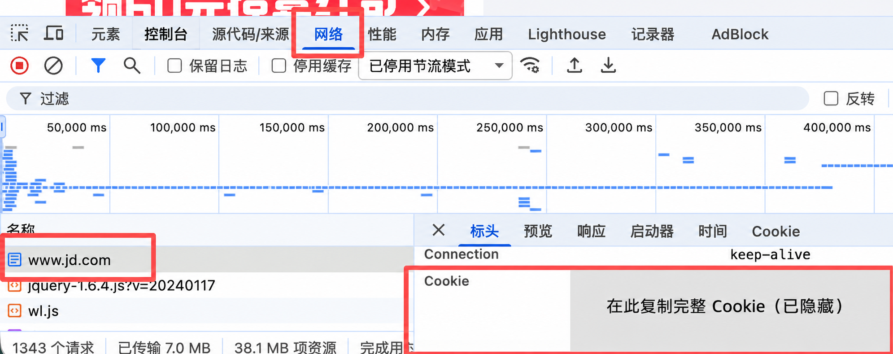

# jd_AutoComment

京东自动评价脚本，以本地 `jd` 根目录程序为基准整理（与提供的 `jd_AutoComment-1.5.2.zip` 中的两个 Python 程序一致）。保留商品评价、追评及服务评价处理逻辑，以及图片获取失败后重试、无图回退等功能。

> 普通运行会实际提交评价。请仅用于本人账号，并核实生成内容是否符合真实购物体验；不要发布虚假评价或盗用他人评价、图片。使用前请自行确认平台规则。

## 快速使用

需要安装 Python，建议使用 Python 3.10 或更新版本。

### 1. 下载项目

```bash
git clone https://github.com/lifujie25/jd_AutoComment.git
cd jd_AutoComment
```

也可以下载项目 ZIP，解压后在项目文件夹打开终端。私有仓库仅限已获授权的账号下载。

### 2. 安装依赖

```bash
python -m pip install -r requirements.txt
```

如果电脑使用 `python3` 命令，请将本文中的 `python` 换为 `python3`。Windows 也可以使用 `py`。

推荐先创建虚拟环境，再安装依赖，避免影响其他项目：

**Windows（命令提示符 CMD）：**

```bat
py -m venv .venv
.venv\Scripts\activate.bat
python -m pip install -r requirements.txt
```

**macOS / Linux：**

```bash
python3 -m venv .venv
source .venv/bin/activate
python -m pip install -r requirements.txt
```

### 3. 获取自己的 Cookie

1. 使用 **Google Chrome（谷歌浏览器）** 打开 [京东官网](https://www.jd.com/)，登录自己的账号。
2. 按 **F12** 打开开发者工具；如果快捷键无效，可右键页面选择“检查”。macOS 可按 `⌘ + ⌥ + I`。
3. 点击 **“网络”（Network）** 选项卡，然后刷新京东页面，让请求重新显示。
4. 在左侧请求列表选中 `www.jd.com` 等京东页面请求。
5. 在右侧点击 **“标头”（Headers）**，找到 **“请求标头”（Request Headers）** 下的 **`Cookie`**。
6. 复制 `Cookie` 后面的**完整值**，不要包含字段名 `Cookie:`；也不要复制响应头里的 `Set-Cookie`。



> 图片仅用于演示位置，Cookie 内容已隐藏。Cookie 相当于账号登录凭据，不要发给他人、放进截图、提交到 Git 或粘贴到 Issue。

### 4. 将 Cookie 填入 config.yml

用文本编辑器打开项目根目录中的 `config.yml`：

```yaml
user:
  cookie: '''填入cookie'''
```

将 **`填入cookie`** 替换成刚才复制的完整 Cookie，保留两侧的三个英文单引号及缩进。示例（仅演示格式，不能用于登录）：

```yaml
user:
  cookie: '''a=1; b=2; c=3'''
```

保存后即可运行。Cookie 请保持在同一行，不要额外加上 `Cookie:`。如果内容本身带有英文单引号，YAML 中需写成两个连续单引号进行转义。

**经常更新代码的用户：** 推荐先复制 `config.yml` 为 `config.user.yml`，再在 `config.user.yml` 中填入 Cookie。程序会优先读取此文件，并且 Git 默认忽略它。存在 `config.user.yml` 时，仅修改 `config.yml` 不会生效。

```bash
# macOS / Linux
cp config.yml config.user.yml
```

```bat
:: Windows CMD
copy config.yml config.user.yml
```

> `config.yml` 是仓库中的配置模板。直接填入真实 Cookie 后，不要将该修改提交或推送到 Git。

### 5. 运行脚本

建议先预览：

```bash
python auto_comment_plus.py --dry-run
```

`--dry-run` 仍会联网读取账号/商品数据，但不会上传图片或提交评价。确认配置和输出后，正式执行：

```bash
python auto_comment_plus.py
```

普通执行会处理待评价订单、待追评及服务评价，请先确认愿意执行这些操作。脚本单轮运行，不自动循环重试。

## 常用命令

```bash
# 查看帮助
python auto_comment_plus.py --help

# 预览并显示详细日志
python auto_comment_plus.py --dry-run --log-level DEBUG

# 保存运行日志
python auto_comment_plus.py --log-level INFO -o run.log
```

日志可能包含订单、商品或账号相关信息。分享日志前请自行脱敏，不要上传原始日志。

## 常见问题

- **提示缺少模块：** 使用运行脚本的同一个 Python 执行 `python -m pip install -r requirements.txt`，有虚拟环境时先激活。
- **Cookie 配置有误：** 将配置中的 `填入cookie` 替换成自己的完整 Cookie，并检查是否存在优先生效的 `config.user.yml`。程序只检查 Cookie 是否为空，不会自动识别占位文本；必须先替换占位文本再运行。
- **无法读取评价列表 / Cookie 失效：** 在浏览器重新登录后获取新的完整 Cookie。接口变更、网络或账号风控也可能导致失败，脚本不保证持续可用。
- **获取图片失败：** 本版本仅使用旧图片接口，失败后等待 10 秒重试一次；仍失败则回退到无图评价。正常返回空图片列表时不重试。
- **不自动打开浏览器：** 本项目不需要 Playwright，Cookie 由用户在浏览器手动获取。

## 本地测试

安装依赖后，在项目根目录执行：

```bash
python -m unittest discover -s tests -v
```

已有测试使用模拟请求，不会实际提交评价。

## 来源与鸣谢

感谢原作者及相关项目：

- [Dimlitter/jd_AutoComment](https://github.com/Dimlitter/jd_AutoComment)
- [qiu-lzsnmb/jd_lzsnmb](https://github.com/qiu-lzsnmb/jd_lzsnmb)
- [2274900/JD_comment_spider](https://github.com/2274900/JD_comment_spider)

本仓库以本地 `jd` 根目录的程序为准整理，两个 Python 程序与根目录逐字节一致；补充安装、配置和 Chrome 获取 Cookie 图文说明，保留代码中的原作者署名。仓库只包含无真实凭据的配置模板。

## 使用声明

本项目仅供 Python 学习交流，不用于商业盈利活动。请遵守平台规则及适用法律，尊重他人评价和图片权益，并自行承担使用后果。
